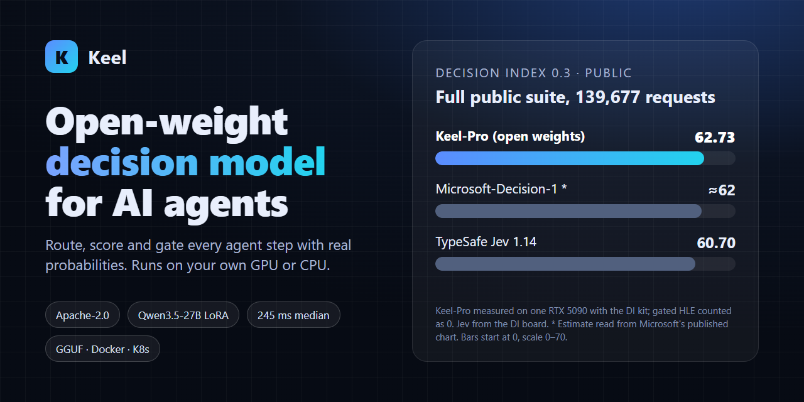

# Press kit

Everything you need to write about Keel, in one place. All numbers link to the run that produced them.

Image: [`docs/media/keel-social-card.png`](media/keel-social-card.png) (1280 × 640, built from
[`keel-social-card.html`](media/keel-social-card.html)). Free to reuse with credit.

## In one line

Keel is an open-weight decision model for AI agents: send text and a typed question (pick one, rate it, yes/no) and get
probabilities back, on your own machine.

## In 50 words

Keel answers the small decisions inside AI agents: where to route a ticket, how risky a change is, whether to act or ask.
Keel-Lite is a 13M-parameter model that answers on a CPU in milliseconds. Keel-Pro, a Qwen3.5-27B LoRA, scores 62.73 on the
Decision Index public suite. Both are Apache-2.0.

## Key facts

| | Keel-Lite | Keel-Pro |
|---|---|---|
| What | CPU decision model (ONNX) | GPU decision model (LoRA on Qwen3.5-27B) |
| Size | 13M parameters, 17.7 MB | 27B base + 217.6M trained, 0.81 GB adapter |
| Runs on | Any CPU | One NVIDIA GPU (~21 GB in 4-bit; Q4 GGUF is a 16.8 GB file) |
| Speed | ~15 ms per request | 245 ms median per request (RTX 5090) |
| Decision Index 0.3, public | not built for it | **62.73**, full public suite, 139,677 requests |
| Licence | Apache-2.0 | Apache-2.0 |
| API | System One wire (Jev- and MSD1-compatible) | Same, model `decider-pro-1.0.0` |

## How to describe the result (accurately)

| Say | Avoid |
|---|---|
| "Level with Microsoft-Decision-1 and above TypeSafe Jev 1.14 on the Decision Index public suite" | "Beats Microsoft" (MSD1 ≈62 is read from Microsoft's chart, not measured by us) |
| "Measured on the full public suite, self-reported, HLE counted as 0" | "Official leaderboard score" (the board run is pending) |
| "An open-weight 27B LoRA" | "A small model" (Keel-Pro is bigger than MSD1's 9B) |

Microsoft-Decision-1 is a 9B model (vendor-reported). Keel-Pro uses a 27B base, so it reaches the same score with a larger
model. Its advantage is that the weights are open and it runs on your own hardware. A smaller distilled version is in progress.

## Links

| | |
|---|---|
| Code | https://github.com/neerumsr/Keel |
| Weights | https://huggingface.co/neerumsr/keel-pro (adapter) · https://huggingface.co/neerumsr/keel-pro-GGUF (llama.cpp) |
| The full story, with diagrams | [Keel-Pro story](keel-pro.md) |
| Every eval run | [di-results.md](../artifacts/parity/pro/di-results.md) |
| Benchmark | [Decision Index](https://github.com/apolinario/decision-index) by apolinario |
| Base model | [Qwen/Qwen3.5-27B](https://huggingface.co/Qwen/Qwen3.5-27B) by the Qwen team |

## Credits

Keel-Pro stands on open work: the **Qwen** team's Qwen3.5 base model, **Hugging Face** transformers, PEFT and
bitsandbytes, **llama.cpp** for GGUF, and the **Decision Index** by apolinario for an open, reproducible benchmark.
TypeSafe (Jev) and Microsoft (Microsoft-Decision-1) defined the System One wire format that Keel speaks.

## Cite

See [`CITATION.cff`](../CITATION.cff), or use the BibTeX in the [README](../README.md#citation).

## Contact

Open a [GitHub Discussion](https://github.com/neerumsr/Keel/discussions) or issue. Security reports: [SECURITY.md](../SECURITY.md).
